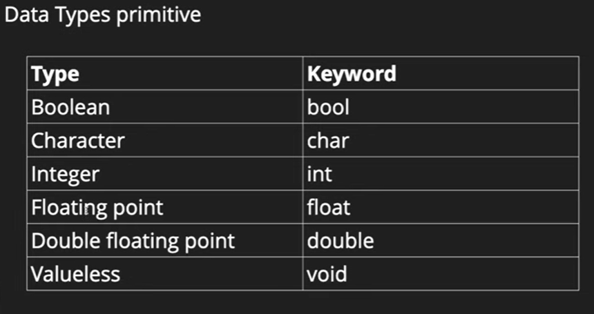
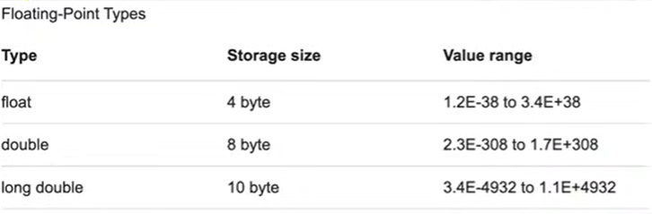
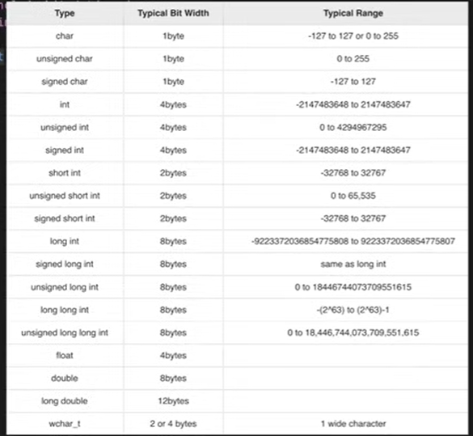

# Libraries

`#include<bites/stdc++.h>` -> has all c++ libraries in it

# Data Types



## Storing Numbers

```cpp
// int
int x = 10;

// long
long x = 15;
long long x = 100000000000000000000000;

// float, double
float x = 5.6;
```





---

# Conditionals

## if-else / nested if-else

## switch

```code
switch(day) {
  case 1:
    cout << "Monday";
  case 2:
    cout << "Tuesday";
  case 3:
    cout << "Wednesaday";
    break;
  case 4:
    cout << "Thurasday";
    break;
  case 5:
    cout << "Friday";
    break;
  default:
    cout << "Invalid";
}
```

- If `day = 1`: O/P = `MondayTuesdayWednesady` -> as no break
- If `day = 3`: O/P = `Wednesady`
- If `day = 10`: O/P = `Invalid`

---

> [!IMPORTANT]
>
> - To know **whether** a character is digit or not use - `isdigit(c)` - (returns boolean)

---

# [Array](../01_array.cc)

An array in C++ is defined as a collection of elements of the same data type stored in contiguous memory locations, allowing multiple values to be accessed under a single variable name. Each element is associated with an index starting from 0, enabling direct access to specific items within the sequence.

Key characteristics of C++ arrays include:

- Fixed size: size is established at declaration and can't be changed.
- Contiguous Memory: elements are store sequentially.
- Uniform Type: all elements share same data type.
- Indexing

> [!NOTE]
> Modern C++ recommends to use `std:vector` or `std:array` over traditional array for better type safety and dynamic capabilities.

## C-style arrays

For:
`int arr[3] = {10, 20, 30};`

- arr behaves like the address of the first element:
  `arr == &arr[0]` (in most expressions)

- Pointer usage:

  ```
  int *ptr = arr;    // points to arr[0]
  ptr++;     // now points to arr[1]
  ```

- Arrays are stored in contiguous memory

- Memory layout (example, assuming `sizeof(int) = 4`):

  Address Value
  1000 10 (arr[0])
  1004 20 (arr[1])
  1008 30 (arr[2])

- Key relation:
  `arr[i] == *(arr + i)`

## STL Array

- `std::array` is a fixed-size container in the C++ STL
- Defined in: `#include <array>`

- KEY Difference:
  - “C array decays to pointer, `std::array` does not.”
  - Decay = automatic conversion
  - A **C array** automatically becomes a **pointer to its first element** in most expressions
  - for STL array `cout << arr;` -> error
  - Correct `cout << arr.data();`
  - Basically: **C-style array** = built-in language construct (not a class) & `std::array` = object of a class (STL container)

---

# [Characters & String](../02_string.cc)

## Char

- `char` is a primitive data type representing a single character

## C-style String (char[], char\*)

- A sequence of characters ending with '\0' (null terminator)
  `{'a', 'b', 'c', '\0'}` -> \0 = Null terminator: represents end
- Stored in contiguous memory

## String

- A class (object) from STL.
- Manages a dynamic character array internally
- std:string behaves like a dynamic array of characters (similar to vectors),
  but it is NOT vector.

### Key differences:

| Feature   | C-style string    | `std::string`     |
| --------- | ----------------- | ----------------- |
| Type      | array / pointer   | class             |
| Size      | manual (`strlen`) | `size()`          |
| Memory    | static or stack   | dynamic (usually) |
| Safety    | ❌                | ✅                |
| Functions | ❌                | ✅                |

> [!ASCII]
> `'0' = 48, '9' = 57 | 'A' = 65, 'Z' = 9 | 'a' = 97, 'z' = 122`
> - char → int digit : `c - '0'` // '5' - '0' = 5
> - int → char digit : `n + '0'` // 5 + '0' = '5'
>
> - lowercase → index : `c - 'a'` // 'c' - 'a' = 2
> - uppercase → index : `c - 'A'` // 'C' - 'A' = 2
>
> - lower → upper : `c - 32` // 'a' - 32 = 'A'
> - upper → lower : `c + 32` // 'A' + 32 = 'a'

---

# Functions

- Functions are set of code which performs something for you.
- Functions are used to modularize code.
- Functions are used to increase readability.
- Functions are used to use same code multiple times.
- void -> returns noting
- parametrized
- non parametrized

---

# C++ STL (Standard Template Library)

The **C++ STL (Standard Template Library)** is a powerful collection of **pre-written, generic classes and functions** in C++ that help perform common tasks efficiently—without implementing everything from scratch.

## STL Components

### **[1. Containers (Data Storage)](../03_stl_containers.cc)**

#### 🔹 Sequence Containers (Ordered)

- `vector` → dynamic array
- `list` → doubly linked list
- `deque` → double-ended queue

#### 🔹 Associative Containers (Sorted)

- `set`, `multiset`
- `map`, `multimap`

#### 🔹 Unordered Containers (Hash-based)

- `unordered_set`
- `unordered_map`

### **[2. Algorithms (Data Processing)](../04_stl_algos.cc)**

Predefined functions to operate on data:

- `sort()`
- `reverse()`
- `find()`
- `binary_search()`

### **3. Iterators (Data Access)**

Used to traverse containers (similar to pointers):

- `begin()` → points to first element
- `end()` → points _after_ last element

### **4. Function Objects (Functors)**

Objects that behave like functions.

```cpp
#include <functional>
cout << greater<int>()(5, 3); // 1 (true)
```

Used with algorithms:

`sort(v.begin(), v.end(), greater<int>());`

### **5. Utilities / Helpers**

Common helper tools:

- `pair`
- `make_pair()` -> used to create a pair object without explicitly specifying its types
- `swap()`
- `min()`
- `max()`

### **6. Allocators (Advanced)**

- Handle memory allocation for containers
- Usually hidden from direct use

### **7. Numeric Library**

For mathematical operations:

- `accumulate()`
- `partial_sum()`
- `iota()`

# [C++ Templates](../06_templates.cc)

- Templates in C++ allow you write generic (type-independent) reusable code at compile time.
- Instead of writing separate functions/classes for int, double, string, etc., you write one version that works for all.

-Types:

1. Function templates
2. Class templates

- Defined using
  `template <typename T>`

  `typename` → tells the compiler “this is a type placeholder”
  `T` → just a name (you can call it anything)

> [!NOTE]
> This is how STL works internally:
> `vector<int> v1;`
> `vector<string> v2;`
> 👉 vector itself is a template class

# Type casting in C++

From C-style casts to modern cast operators — what to use and when

## Implicit cast

- The compiler converts types automatically when it's safe and lossless.

```
int i = 42;
double d = i;      // int → double, no data lost
float f = 3.14;
double g = f;      // widening, always safe
```

C-style cast avoid in C++
`(type)value` — does whatever it takes to convert. No safety checks; silently reinterprets memory if needed.

```
double d = 9.8;
int i = (int)d;        // truncates → 9
char* p = (char*)&d;   // dangerous: raw memory reinterpret
static_cast preferred
```

## static_cast (preferred)

- The everyday cast. Checked at compile time. Use for numeric conversions, void\* ↔ typed pointer, and up/down the class hierarchy (no runtime check).

```
double d = 9.8;
int i = static_cast<int>(d);       // 9 — explicit truncation

void* ptr = &i;
int* ip = static_cast<int*>(ptr);   // void* back to typed ptr
```

## reinterpret_cast (use with care)

- Raw bit reinterpretation. No conversion — just tells the compiler "treat this memory as that type". Used in low-level / hardware code.

```
int x = 65;
char* p = reinterpret_cast<char*>(&x);
// *p == 'A' on little-endian (reads the lowest byte as char)
```

## dynamic_cast (runtime checked)

- Safe downcast in a class hierarchy. Returns nullptr (for pointers) or throws std::bad_cast (for references) if the object isn't actually the target type. Requires at least one virtual method.

```
class Animal { public: virtual ~Animal() {} };
class Dog : public Animal { public: void bark() {} };

Animal* a = new Dog();
Dog* d = dynamic_cast<Dog\*>(a); // succeeds → valid ptr
if (d) d->bark();

Animal* cat = new Animal();
Dog* fail = dynamic_cast<Dog\*>(cat); // returns nullptr
```

## const_cast (rarely needed)

- Removes (or adds) const/volatile. Writing through a pointer to an originally-const object is undefined behaviour — only safe when you know the original object was mutable.

```
void print(char* s) { /* legacy API won't take const */ }

const char* msg = "hello";
print(const_cast<char*>(msg)); // only read, never write through it
```

> [!NOTE]
> Quick rule: reach for static_cast first. Only go lower (reinterpret_cast, const_cast) when you have a concrete reason. Never use C-style casts in new C++ code — they bypass all safety checks silently.
